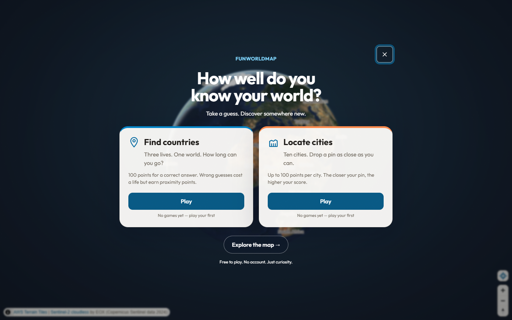
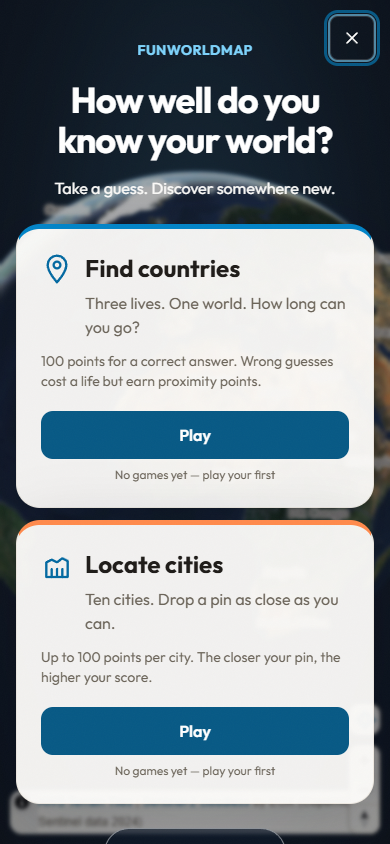
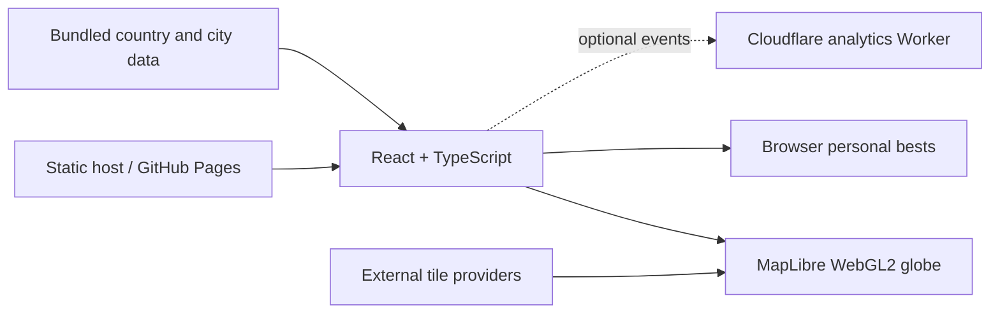

# funworldmap

**Find countries. Locate cities. Explore the world behind every guess.**

[Play now](https://funworldmap.com) · [Get started](#run-locally) · [Contribute](CONTRIBUTING.md) · [Documentation](docs/index.md)

[](https://github.com/GranatenUdo/funworldmap/actions/workflows/ci.yml)
[](https://github.com/GranatenUdo/funworldmap/actions/workflows/codeql.yml)
[](LICENSE)



Free, browser-based geography games on a real 3D world map. No account, installation, or payment required. Play a round, then explore countries and the sources behind their facts.

## Play and explore

- **Find countries:** click the country you are asked to find. Three lives, distance-weighted scoring, and a running streak.
- **Locate cities:** place ten pins as close as possible to the named cities. Scores depend on distance.
- **Explore:** search countries, compare facts, follow neighboring countries, and inspect data sources. The reference dataset covers 193 UN members plus the Holy See and Palestine.
- **Make it yours:** satellite imagery and terrain, a vector-map alternative, light/dark/system themes, and personal bests stored in your browser.

<details>
<summary>See the mobile interface</summary>



</details>

## Run locally

Use **Node.js 22.22.1** (the version in `.nvmrc`) and **npm 10**. Other Node major versions are not currently supported.

```bash
git clone https://github.com/GranatenUdo/funworldmap.git
cd funworldmap
npm ci
npm run dev
```

Open [localhost:5173](http://localhost:5173). The country/city datasets and flags are already bundled; no API keys, accounts, data refresh, or Worker deployment are needed.

```bash
npm run check          # ESLint, TypeScript, and unit tests
npm run docs:check     # Documentation formatting, links, anchors, commands
npm run bundle:budget  # Production build and gzip budgets
```

For browser installation, end-to-end tests, optional environment variables, and Worker development, see [Contributing](CONTRIBUTING.md).

## How it works



Vite 8 builds the static app; Tailwind CSS 4 supplies styling. The browser runs the games and renders the map. Country selection and game navigation use URL hashes. The optional analytics Worker has its own package and lockfile.

### Requirements and limitations

- A modern browser with **WebGL2** and network access to external map services is required for the full experience. Static hosting does not make the app an offline map.
- Search, reference panels, and game controls provide keyboard and screen-reader affordances. **Placing guesses currently requires a pointer or touch.** Automated accessibility tests do not establish full WCAG conformance; see [Accessibility](docs/systems/accessibility.md).
- Data reflects the bundled snapshots, not live geopolitical updates. See [data sources and attribution](docs/systems/data.md).
- Optional telemetry is disabled when its build-time settings are empty. Details and configuration are in [Analytics](docs/systems/analytics.md).

## Join in

[Contribution guide](CONTRIBUTING.md) · [Report a bug or data error](https://github.com/GranatenUdo/funworldmap/issues/new/choose) · [Get support](SUPPORT.md) · [Code of conduct](CODE_OF_CONDUCT.md)

Start with the [documentation index](docs/index.md) for architecture, testing, deployment, and maintenance. The [roadmap](docs/roadmap.md) records deferred ideas, not delivery promises.

Report vulnerabilities privately using the [security policy](SECURITY.md).

## License and credits

Source code is [MIT licensed](LICENSE). Country data, map tiles, fonts, and flag assets retain their upstream terms; attribution and source details are documented in the [data system](docs/systems/data.md) and [map rendering system](docs/systems/map-rendering.md).
